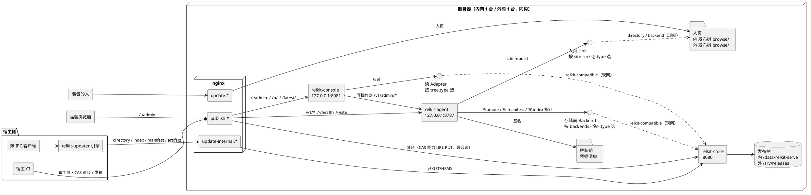
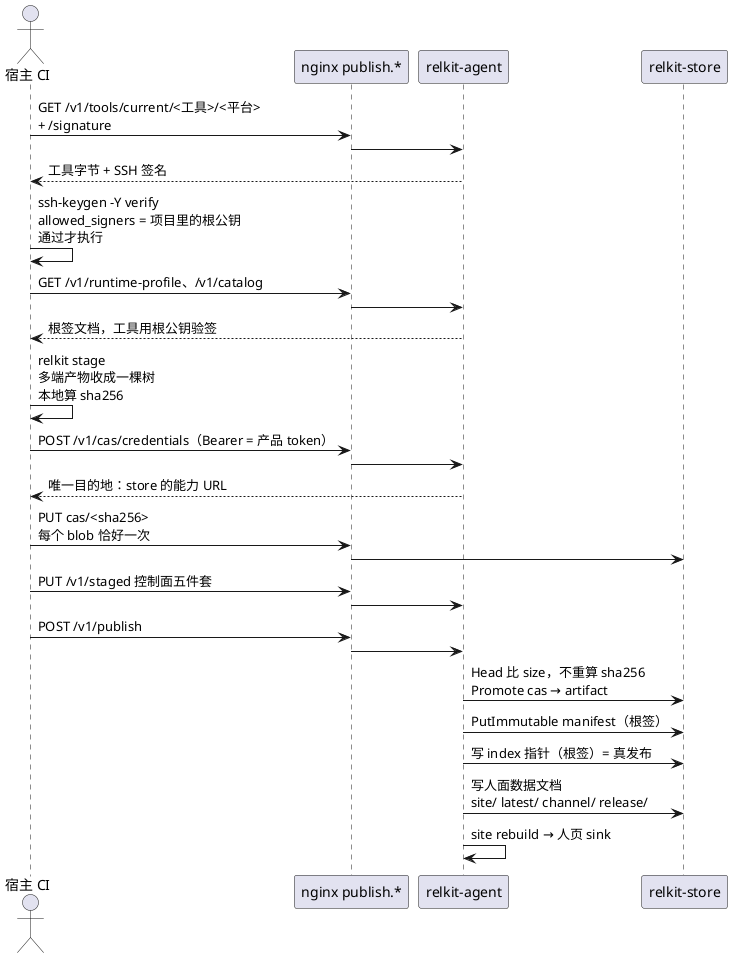
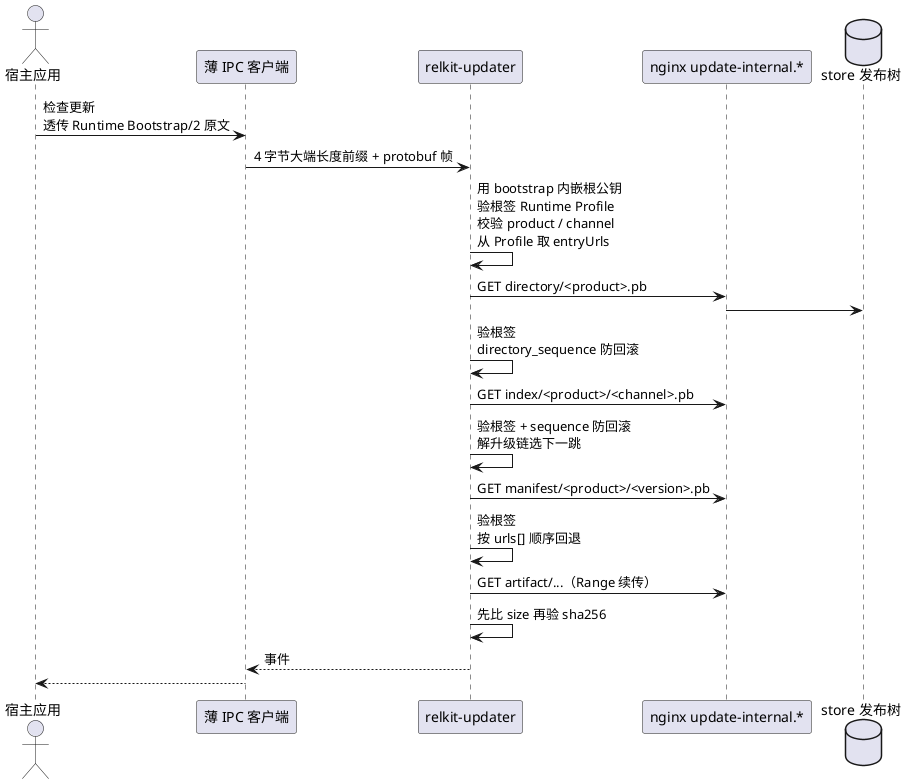
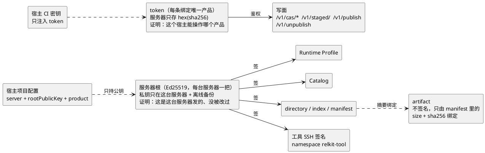
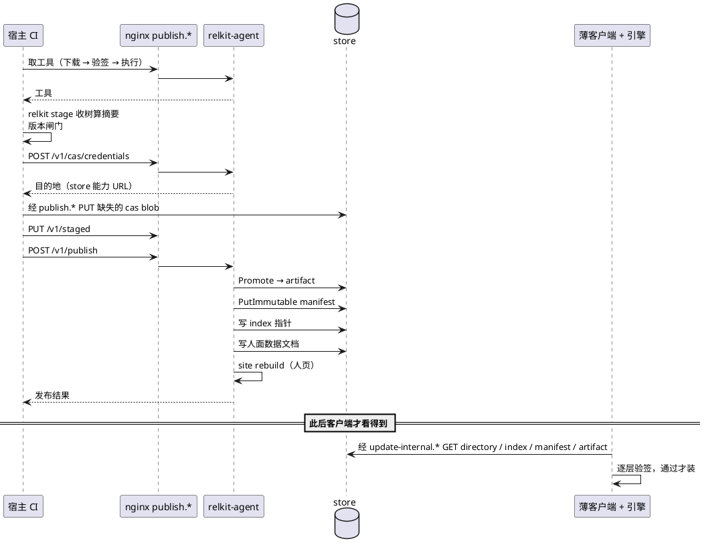
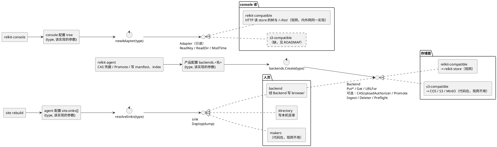

# 拓扑（唯一来源）

---
title: 拓扑（唯一来源）
category: design
created: 2026-10-26
updated: 2026-10-26
status: approved
依据: ADR 0023
---

本文是 relkit 拓扑图的唯一来源。其它文档需要画拓扑时引用本文的对应小节，不再各画一份。图分散在多处必然漂移，而漂移过的图比没有图更误导。

本文只画结构，不重复协议细节。协议看 [SPEC.md](../../SPEC.md)，规矩看 [architecture.md](../architecture.md)，历史决策看 [ADR](../adr/)。

判据只有一条：图和文字里的每个事实，都能在代码或现网配置里找到对应。现网配置的样例在 `scripts/deploy/`（内网 `nginx-intranet.example.conf`，外网 `nginx-public.example.conf`）。

六张图分工：图一总览一台服务器上有什么、域名转到哪；图二发布链路（CI 写面）；图三下载链路（updater 读面）；图四信任与凭据；图五一次发布的时序；图六可替换的接缝（adapter）。

三句话概括现状：每台服务器三个进程；三组域名各管一件事；发布与下载是两条独立链路，唯一交汇点是 store 里的发布树。

图一里的三个圆圈节点是接缝，不是进程：agent 写存储、site rebuild 写人页、console 读发布树，都只经过一个按 `type` 选实现的抽象层，虚线才落到现网的具体实现。换实现只改那一个配置条目，图上的实线不变。接缝本身见第六节。

## 一、总览

三组域名各管一件事，这是内外网同构的部分：

| 域名 | 唯一职责 | 转发目标 |
| --- | --- | --- |
| `publish.*` | CI 写面 + 运营面板入口 | `/v1/`、`/-/health`、`/-/site` → agent 8787；`/-/admin`、`/-/p/`、`/-/latest/` → console 8081；其余 → store 8080 |
| `update-internal.*` | updater 读面（SSOT） | 全部 → store 8080，仅 GET/HEAD；不转发 `/v1/`，所以不提供 `/v1/tools/` 与 `/v1/catalog` |
| `update.*` | 人页 | 全部 → store 8080，仅 GET；store 从发布树渲染 Releases 页，空目录时自己输出「No published catalog yet」。内外网同一形状，没有 console |

三个进程的职责边界：

- `relkit-agent` 是唯一持有根私钥、唯一做签名的进程。它签 Profile / Catalog / directory / index / manifest 与工具的 SSH 签名，签发 CAS 上传凭据，接收 `POST /v1/publish`，经 store 的接口完成 Promote、写 manifest、写 index 指针，最后跑 site rebuild。它自己不经手产物正文。
- `relkit-store` 管发布树：匿名 GET/HEAD（含 Range），凭能力 URL 接收 CI 直传的 `cas/<sha256>`，接受 agent 的受控写入。不含签名能力。
- `relkit-console` 只经读 Adapter 读取发布树，Adapter 由配置里的 `tree` 条目决定（现网 `relkit-compatible`，即经 HTTP 读本机 store），console 不直接打开本机目录。用户、角色、产品、token 这些写操作全部转 agent 的 `/v1/admin/*`，自己不写发布树。

所以"谁写发布树"有两个入口：CI 凭 agent 签发的能力 URL 直接 PUT `cas/`；其余写入（`artifact/`、`manifest/`、`index/`、人面数据文档）都由 agent 经 store 接口完成。

内外网不是同一套配置的复制品，差异只有这些：

| 项 | 内网 | 外网 |
| --- | --- | --- |
| 域名 | `*.devcloud.woa.com` | `*.firoyang.com` |
| TLS 终结 | WOA 网关在箱外终结，箱上只 `listen 80` | nginx stream 按 SNI 分流（`stream-sni.conf`）→ `127.0.0.1:4443`，vhost 用 `ssl proxy_protocol` |
| CI 写面 scheme | `http://`（蓝盾池到 443 被拦，箱上无 443 监听；已接受的偏离 D2） | `https://` |
| store 数据目录 | `/data/relkit-serve` | `/srv/releases` |
| agent 产品根 | `/data/relkit` | `/srv/relkit` |
| 人页 sink | `type: backend`，写进发布树 `browse/` | 同左，`type: backend`（`serve`） |
| agent `publicURL` | `http://publish.devcloud.woa.com` | `https://publish.firoyang.com` |

CI 一律打域名，不打裸 IP、不打回环 hostname，也不建 SSH 隧道借道 loopback 端口。

## 二、发布链路

发布是从 CI 到发布树的一条单向链。字节只跨「CI → 数据面」一次，之后的写入都在服务器内部完成。

要点：

- 宿主仓不放 `relkitw`、不钉 relkit 版本、不放组件摘要。取工具固定三步：下载、验签、执行，脚本里不含版本号与摘要，所以能写进流水线 yaml 并冻结。
- 工具只在 `publish.*` 上提供。下载地址由 agent 用自己配置的 `publicURL` 签出，调用方传什么 baseUrl 一律忽略；`publicURL` 没配或配成 loopback 时拒绝发布工具并返回 409。
- 写 index 指针才算发布完成。此前都只是把字节搬到位。
- 下线产品是不可逆操作：注册消失、token 失效，发布树目录留在磁盘上。面板会先做一次预演，把 agent 的判断逐条列出来，确认后才真删。

## 三、下载链路

下载是另一条独立链，客户端从不接触 agent，也不持有任何 token。

要点：

- 薄客户端只负责找引擎、起子进程、编解码帧、把事件交给 UI。解析 bootstrap、解析 index/manifest、验签、算摘要、决定版本、管理安装目录全部在引擎里。任何一处客户端开始解析协议文档，就是架构被破坏。
- 入口地址不由宿主手写：entryUrls 写在根签的 Runtime Profile 里，宿主侧若另行声明，必须与之一致，否则报 `PROFILE_INVALID`（`internal/updater/engine.go`）。
- 验签失败不降级、不换源、不使用明文。防回滚只有前进。
- 下载不需要 token。内容由根签名保证真伪，鉴权只在写面存在。

## 四、信任与凭据

两样东西，各管一件事，不能互相替代。

要点：

- 文档靠根签名认证，文档里点名的文件靠摘要绑定。两层就够，没有产品级签名密钥，也没有第二层签名文档。
- 一个应用只认一台服务器的根。根公钥来自那台服务器产出的接入配置，原样写进宿主项目配置；CI 用它验工具，宿主构建把它写进 Runtime Bootstrap 供引擎使用。
- token 不做任何验证服务器或验证内容的事。读面（`update-internal.*`）完全不需要 token。
- 运营账户（`/v1/admin/*`）是第三种凭据：登录会话，由 agent 管理，只用于面板，不进 CI，也不进客户端。
- 钥匙位置只登记在凭据清单（`relkit.custody-manifest/1`），程序按 keyId 取，规矩见 [architecture.md](../architecture.md) 第三节。

## 五、一次发布的时序

把发布与下载串起来看，一次完整发布长这样。

时序上有一处容易误会：人页永远滞后于协议面。数据文档写在 index 提交之后，某次 rebuild 失败只让人页旧一会儿，不会回滚已经生效的协议 index。

## 六、可替换的接缝

图二到图五把 store 画成一个固定节点，那是现网实例。结构上，凡是"数据落在哪、从哪读"的地方都隔着一层小接口，调用方只认接口，不按实现类型分叉。共三处，三处同形：调用方手里只有一个带 `type` 的配置条目，工厂按 `type` 选实现，实现自己解析条目里的其余参数。

| 接缝 | 接口位置 | 选择方式 | 决策 |
| --- | --- | --- | --- |
| 存储面 Backend | `internal/backends/base.go` | 产品配置 `backends.<名>.type`（`publishTo` 选用哪些），工厂 `backends.Create` | [ADR 0008](../adr/0008-cas-data-plane-contract.md) |
| 人页 sink | `internal/site/site.go` | agent 配置 `site.sinks[].type`，工厂 `resolveSinks` | [ADR 0015](../adr/0015-declarative-site-sinks.md) |
| console 读 Adapter | `cmd/relkit-console/adapters.go` | console 配置 `tree.type`，工厂 `newAdapter`；现网只有 `relkit-compatible`，内外网同一条目形状 | [ADR 0016](../adr/0016-serve-split-store-console.md) |

要点：

- 可选能力用独立小接口表达（`backend.(backends.CASUploadAuthorizer)` 这类断言），不往 Backend 主接口里塞。两种存储后端都实现了 CAS 直传授权和 Promote，所以图二的直传链路对 COS 同样成立，差别只是能力 URL 换成预签名 URL。
- 三处接缝不对称：存储面能换成 COS，人页也能跟着写过去，但 console 没有 S3 读 adapter。数据面一旦换成 COS，面板会读不到发布树。现网内外都是 store，不受影响，缺口登记在 [ROADMAP](../ROADMAP.md)。
- 换实现只改配置，不改调用方。这是这三个接口存在的全部理由；哪天某处开始按实现类型写 `if`，接缝就失效了。
- 实现不外露。对其他切面（进程入口、配置文件顶层、命令行参数、部署脚本、本文以外的文档）来说，只看得见抽象条目 `{type, ...}`；实现名和实现专属参数（如 `url`、`bucket`）只在条目内部，由该实现的构造函数解析。部署脚本整块搬运 `tree` 条目、不读其内容，也不去探测本机装了哪个 store。反例是已删除的 console `rootAdapter` 与过渡期的顶层 `store` 键：前者让一个实现直接和本机目录打交道，后者把实现名和它的地址提到了配置顶层，两者都让其他切面认识了实现。
- type 名在三处接缝间共用：console 的 `relkit-compatible` 读的就是存储面 `relkit-compatible` 写进去的同一套协议，一个协议一个名字；将来的 S3 读 adapter 同样叫 `s3-compatible`。

## 相关

- [architecture.md](../architecture.md)：现行架构，哪些规矩不能破
- [ADR 0023](../adr/0023-desktop-updater-epoch.md)：桌面更新断代决策，本文的结构以其为准
- [publish-agent.md](publish-agent.md)：发布协议与 HTTP 表面细节
- [SPEC.md](../../SPEC.md)：协议与客户端内嵌合约
- [trust-root-custody.md](../guide/trust-root-custody.md)：根密钥放哪、怎么确认在
