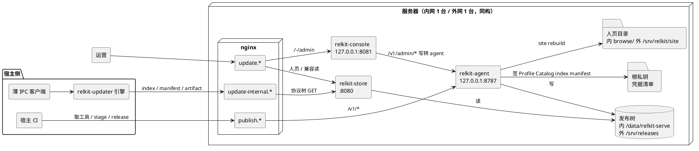
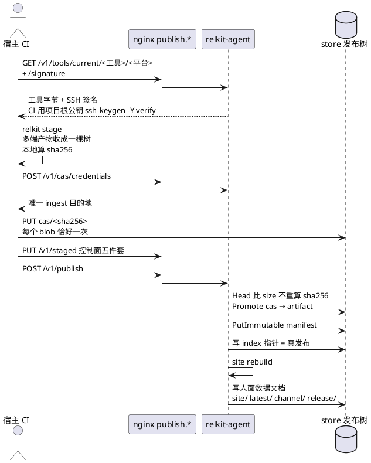
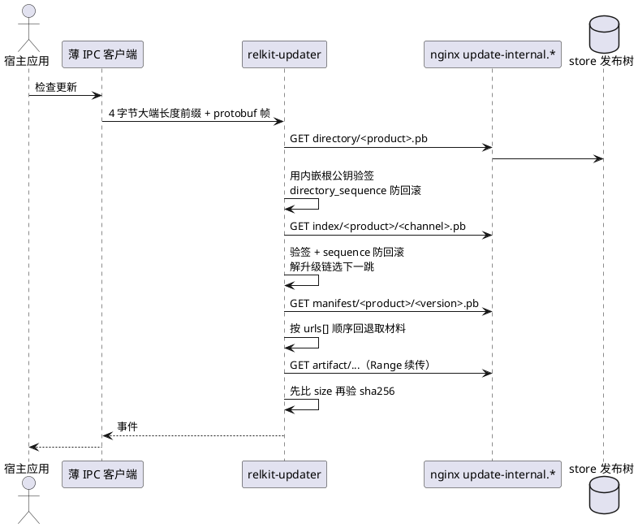
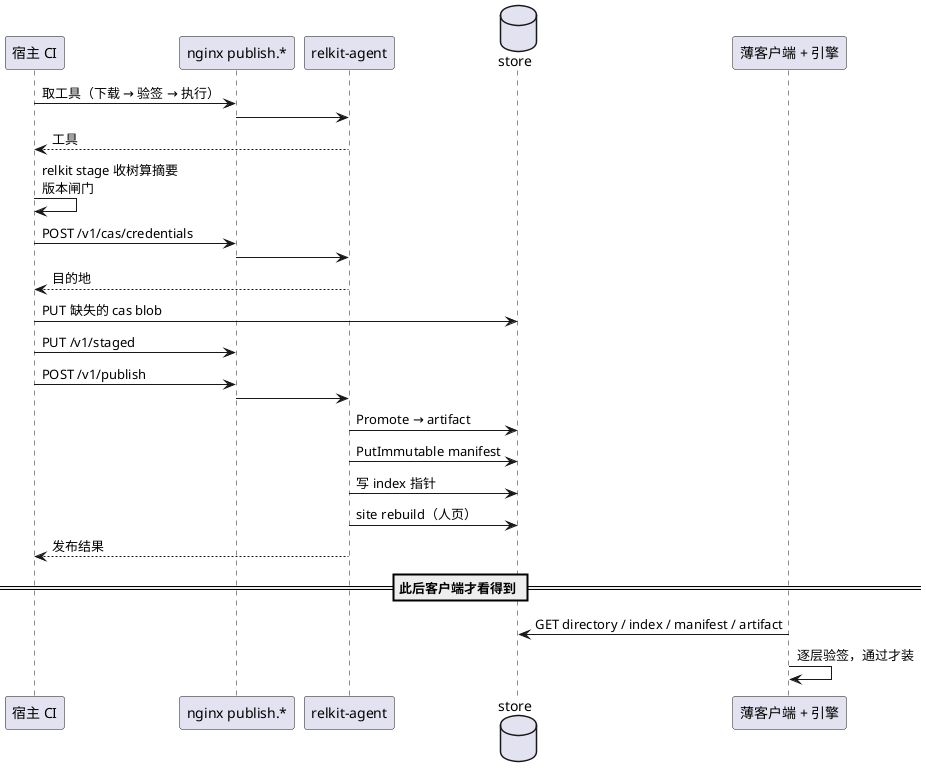

# 拓扑（唯一来源）

---
title: 拓扑（唯一来源）
category: design
created: 2026-10-26
updated: 2026-10-26
status: approved
依据: ADR 0023
---

本文是 relkit 拓扑图的唯一来源。其它文档需要画拓扑时引用本文的对应小节，不再各画一份——图分散在多处必然漂移，而漂移过的图比没有图更误导。

本文只画结构，不重复协议细节。协议看 [SPEC.md](../../SPEC.md)，规矩看 [architecture.md](../architecture.md)，历史决策看 [ADR](../adr/)。

四张图分工：图一总览内外网两台机器上有什么；图二发布链路（CI 写面）；图三下载链路（updater 读面）；图四一次发布的时序。

三句话概括现状：每台服务器三个进程；三组域名各管一件事；发布与下载是两条独立链路，唯一交汇点是 store 里的发布树。

## 一、总览

三组域名各管一件事，这是内外网同构的部分：

| 域名 | 唯一职责 | 转发目标 |
| --- | --- | --- |
| `publish.*` | CI 写面，兼取工具 | `/v1/` → agent 8787；`/-/admin`、`/-/p/`、`/-/latest/` → console 8081；其余 → store 8080 |
| `update-internal.*` | updater 读面（SSOT） | 全部 → store 8080，仅 GET/HEAD |
| `update.*` | 人页 | 静态目录；`/-/admin` 等 → console |

三个进程的职责边界：

- `relkit-agent` 是唯一持有根私钥的进程，也是唯一写发布树的进程。它签 Profile / Catalog / index / manifest，签工具与工具文件的 SSH 签名，接收 CI 的发布请求，跑 site rebuild。
- `relkit-store` 只读写发布树并按内容寻址提供下载，不含签名能力。
- `relkit-console` 不碰存储，所有写操作转 agent 的 `/v1/admin/*`。

内外网不是同一套配置的复制品，差异只有这些：

| 项 | 内网 | 外网 |
| --- | --- | --- |
| 域名 | `*.devcloud.woa.com` | `*.firoyang.com` |
| TLS 终结 | WOA 网关在箱外终结，箱上只 `listen 80` | nginx stream 按 SNI 分流（`stream-sni.conf`）→ `127.0.0.1:4443`，vhost 用 `ssl proxy_protocol` |
| CI 写面 scheme | `http://`（蓝盾池到 443 被拦，箱上无 443 监听） | `https://` |
| store 数据目录 | `/data/relkit-serve` | `/srv/releases` |
| agent 产品根 | `/data/relkit` | `/srv/relkit` |
| 人页 | store 的 `browse/`（site sink `type: backend`） | `/srv/relkit/site`（nginx 直接伺服静态目录） |

CI 一律打域名，不打裸 IP、不打回环 hostname，也不建 SSH 隧道借道 loopback 端口。

## 二、发布链路

发布是从 CI 到发布树的一条单向链。字节只跨「CI → 数据面」一次，之后所有分发都在服务器内部完成。

要点：

- 宿主仓不放 `relkitw`、不钉 relkit 版本、不放组件摘要。取工具固定三步：下载、验签、执行，脚本里不含版本号与摘要，所以能写进流水线 yaml 并冻结。
- 工具由 agent 用自己配置的 `publicURL` 签出下载地址。调用方传什么 baseUrl 一律忽略；`publicURL` 没配或配成 loopback 时拒绝发布并返回 409。
- 写 index 指针才算发布完成。此前都只是把字节搬到位。
- 发布不可逆的部分在下线产品时：注册消失、token 失效、发布树目录留在磁盘上。面板会先做一次预演，把 agent 的判断逐条列出来，确认后才真删。

## 三、下载链路

下载是另一条独立链，客户端从不接触 agent，也不持有任何 token。

要点：

- 薄客户端只负责找引擎、起子进程、编解码帧、把事件交给 UI。解析 bootstrap、解析 index/manifest、验签、算摘要、决定版本、管理安装目录全部在引擎里。任何一处客户端开始解析协议文档，就是架构被破坏。
- 一个应用只认一台服务器的根。根公钥来自它注册的那台服务器产出的接入配置，原样写进宿主项目配置。
- 验签失败不降级、不换源、不使用明文。防回滚只有前进。
- 下载不需要 token。内容由根签名保证真伪，鉴权只在写面存在。

## 四、一次发布的时序

把上面两张图串起来看，一次完整发布长这样。

时序上有一处容易误会：人页永远滞后于协议面。数据文档写在 index 提交之后，某次 rebuild 失败只让人页旧一会儿，不会回滚已经生效的协议 index。

## 相关

- [architecture.md](../architecture.md)：现行架构，哪些规矩不能破
- [ADR 0023](../adr/0023-desktop-updater-epoch.md)：桌面更新断代决策，本文的结构以其为准
- [publish-agent.md](publish-agent.md)：发布协议与 HTTP 表面细节
- [SPEC.md](../../SPEC.md)：协议与客户端内嵌合约
- [trust-root-custody.md](../guide/trust-root-custody.md)：根密钥放哪、怎么确认在
